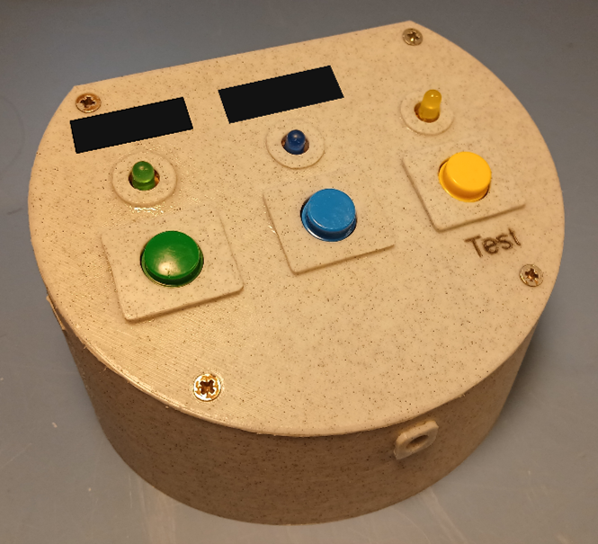
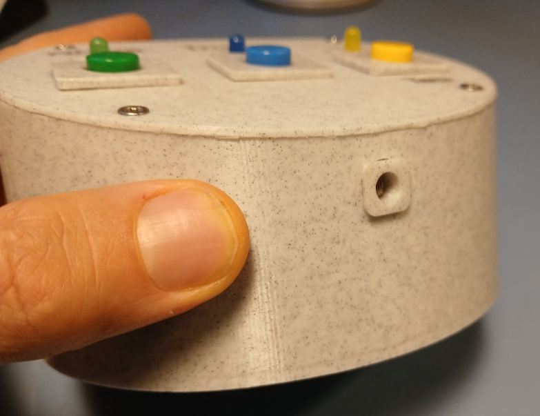
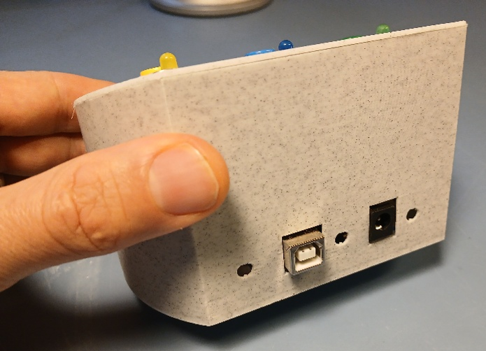
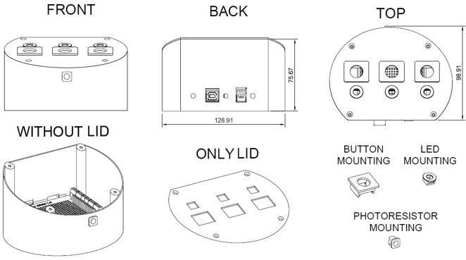
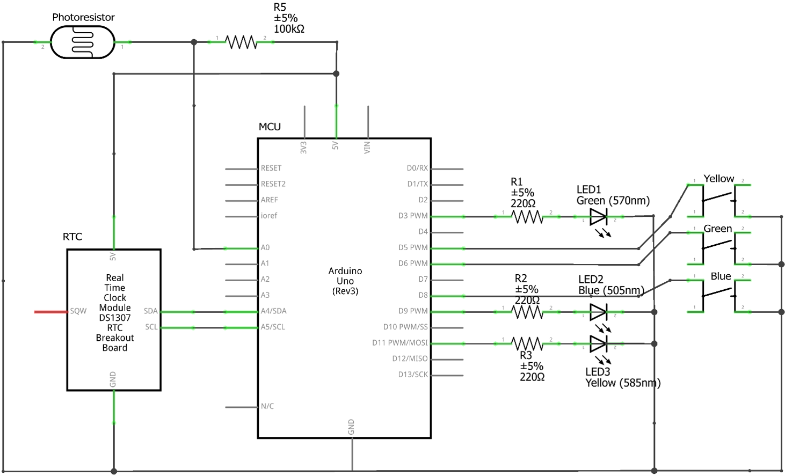
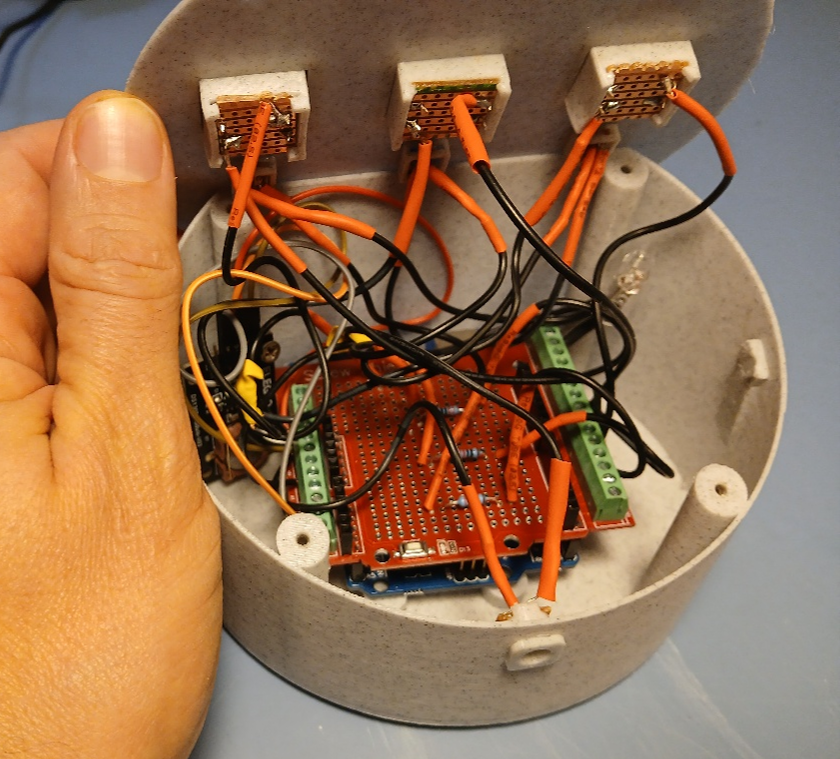
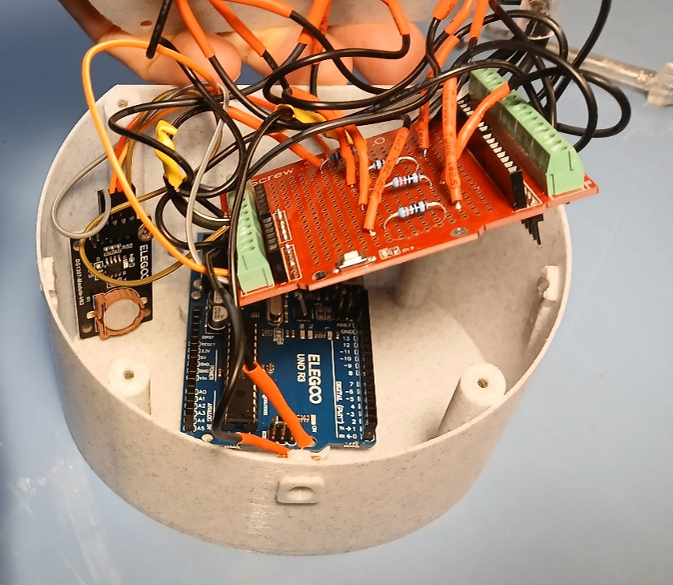
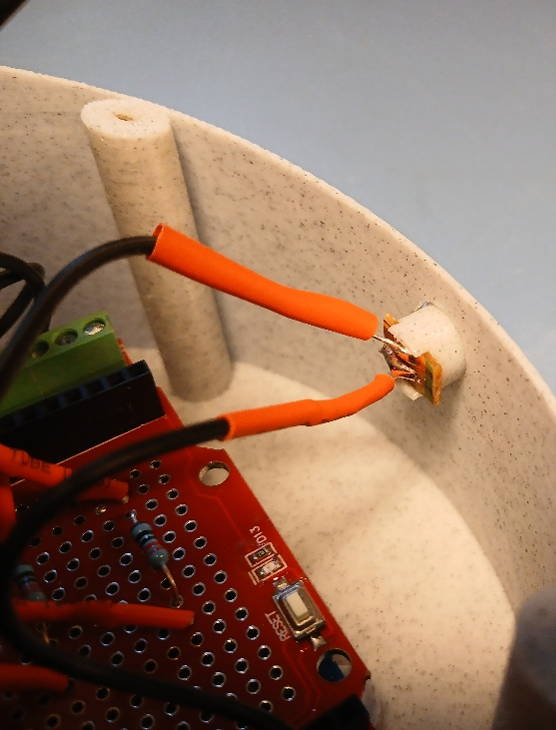

MyBuddyLED: A gentle, non-intrusive but persistent reminder device

This is version 1.0 of the README, written on October 27th 2026

Project designed and built by Troels

Contact: troelsdtu@gmail.com

1	Background

1.1	The problem to be solved

It can be hard to remember to do tasks, e.g.:
- If the task doesn’t have an easy once-a-day schedule. For example, some medicine needs to be taken according to hard-to-remember schedules, e.g. once a day for 14 days, then every third day for 14 days.
- For people who are especially absent-minded, e.g. an ADHD person deep in a project, kids, or someone with dementia or other cognitive challenges. 

1.2	Current solutions

For some tasks it makes sense to set an alarm on your phone to help you remember but sometimes this is not effective, e.g. if you are not at the place where you can do the task when the alarm goes of. E.g. you need to take a pill before going to bed but sometimes you go to bed at 9 and sometimes at 11; if the alarm goes off at 9 you may still be out and about and not near your pills, in which case you may forget to take the pill when you go to bed at 11, or you need to keep snoozing your alarm until you are home. And the opposite situation is obviously no good either, being woken up by your alarm at 11 when you have been sleeping since 9...

Another option is to set a pop-up notification on your phone that stays on your lock screen. However, there is still a risk that you will overlook this and/or that it will be crowded out by other notifications. 

In some cases, a digital dashboard may be a good solution. However, these are somewhat expensive and often only placed in one room in the house/apartment. If the dashboard is placed e.g. in the kitchen it would be easy to forget to take a pill that needs to be taken before bedtime. Dashboard notifications are also relatively discreet so can easily be overlooked by absent-minded people.  

A simple solution is to put a post-it on e.g. your bathroom mirror but this quickly blends into the background and is easy to overlook, and does not accommodate a changing task schedule such as with pills with a 28-day cycle. 

2	The MyBuddyLED device

2.1	Solution specifications

The MyBuddyLED device was designed according to the following specifications:

Need-to-have functionality:
- Give the user a persistent, noticeable but gentle task reminder that is less likely than existing solutions to be lost in the shuffle.
- Programmable to accommodate different task schedules

Nice-to-have features: 
- More than one reminder, e.g. for two people or one person to remember two different tasks.
- Option to choose specific clock times on the day when each reminder should activate and de-activate.
- An old-school look and feel, with tactile buttons and an aesthetically pleasing design (though tastes obviously differ)

2.2	Device description and functionality

The MyBuddyLED device is a small (12.5 x 10 x 7.5 cm) device with three LEDs (green, blue and yellow) and three corresponding buttons. 

FIGURE 1:  Device. Labels over LEDs (redacted here) can be customized.

FIGURE 2: Front of device, showing aperture for photoresistor

FIGURE 3: Back of device, showing USB port and power connection. Small holes included for cooling (probably not needed)

The device is initially programmed with the specific schedules for the two reminder timers it can keep track of, respectively Timer1 which controls the green LED and Timer2 which controls the blue LED.
When the reminder is triggered, the corresponding LED starts pulsing gently, with a light intensity that matches the ambient light so that the LED is noticeable in bright ambient light but does not seem too intense in dim light conditions (e.g. in the night when it is not desirable with a very intense blinking light). The light intensity is measured by a photoresistor mounted at the front of the device enclosure.
The pulsing light is more noticeable than a light which is just continuously on. 

The user can switch off the LED by pressing the corresponding button. The LED will then be off until the next trigger time point.

The yellow light is a status light which indicates that the device is on. This is helpful in a situation where neither of the reminder lights are pulsing because the user could otherwise worry that the device is off and that they would not get their reminders. 

Pressing the yellow button triggers an LED test in which all three LEDs blink three times at maximum intensity, then resume the normal schedule. This is to make it possible to test that all LEDs work. 

The device can be powered by either USB-B (5V DC) or barrel jack (5V DC). 

The USB-B port is also used for uploading the personally tailored code to the device initially.

2.3	Physical enclosure

FIGURE 4: Device enclosure components

The device enclosure consists of the following parts:
- the enclosure bottom, with a hole in front for the photoresistor mounting. The inside bottom has screw holes for fixating the MCU with one or more screws, and there are screw holes for mounting the lid.
- The enclosure lid, with holes for three button mountings and three LED mountings
- Three button mountings. These are glued to the enclosure lid, in their designated holes. If the parts are printed in PLA, a glue activator should be used on the parts before gluing with cyanoacrylate glue.
- Three LED mountings, to be glued to the lid in their designated holes.
- One photoresistor mounting, to be glued into place in the designated hole in the enclosure bottom.  

The design was made in Autodesk Fusion and designed with easy printability in mind, i.e. minimum overhangs and need for print supports.

It may be preferable to print in a dark color; otherwise relatively much light from the circuit boars’ onboard LEDs will be visible through the enclosure at night. 

The STL files have been uploaded to GitHub. 

2.4	Electronics

FIGURE 5: Circuit schematic

The device’s microcontroller unit (MCU) is an Elegoo clone of an Arduino Uno R3.

A screw-connection prototyping shield is mounted on top of the MCU and all peripherals are connected via this shield.

FIGURE 6: Device with lid lifted, showing prototyping shield on top of microcontroller

The LEDs are attached to Pulse Width Modulation (PWM) pins, soldered onto the shield in series with 220 Ω resistors, as follows: Green LED on pin 3, blue LED on pin 9 and yellow LED on pin 11. Using PWM pins allows the light intensity to be adjusted.

The buttons are attached to pins configured as pullup input pins, as follows: green button on pin 6, blue button on pin 8 and yellow button on pin 5. When pressing the buttons, the digital state of the pins go from HIGH (open circuit) to LOW (short circuit).

As shown in Figure 5, the push buttons (as well as the LEDs and photoresistor) are mounted on perfboard that is cut to size and slotted into the 3D-printed mountings.  

The DS1307 Real Time Clock module keeps the time and ensures that reminder triggers happen at the right dates and clock times. It is attached to the 5V and ground pins, its SDA pin is attached to the MCU’s A4 pin and its SCL pin is attached to the MCU’s A5 pin. 

FIGURE 7: Real Time Clock module visible on the left

A photoresistor is mounted at the front of the device and used for measuring the level of ambient light, in order to regulate the light intensity of the LEDs. The photoresistor is connected to a 100k Ω resistor soldered on the prototyping shield which in turn is connected to the MCU’s 5V pin, forming a voltage divider. The voltage between the resistor and photoresistor is measured on the MCU’s pin A0 and is inversely proportional with the level of ambient light; if there is a lot of ambient light, the photoresistor’s resistance will drop, moving the voltage at A0 closer to ground.  

FIGURE 8: Photoresistor

2.5	Complete parts list

- Arduino Uno R3 microcontroller, or clone
- Arduino Uno R3 Prototype Shield (e.g. https://ardustore.dk/produkt/prototype-screw-arduino-uno-r3-pcb-board)
- DS1307 Real Time Clock module
- Three 220 Ω resistors
- One 100.000 Ω resistor
- One 3 mm CdS photoresistor (e.g. https://www.cnkls.com/3248.html)
- USB-A to USB-B data cable for uploading customized source code to MCU.
- Standard Arduino Uno type DC power supply:
    Voltage: 7V to 12V DC is recommended.
    Connnector Type: 5.5mm cylindrical plug with a 2.1mm center pin hole.
    Polarity: The adapter must be Center-Positive (the inside pin is positive, and the outside sleeve is negative/ground).
- Insulated wiring for soldered connections between MCU and peripherals
- Solder
- Perfboard for mounting the LEDs, push buttons and photoresistor.
- Three 12 x 12 mm pushbuttons (e.g. https://ardustore.dk/produkt/tactile-print-push-button-12x12x7-3mm)
- Three matching push button caps, in blue, green and yellow.	(e.g. https://ardustore.dk/produkt/tactile-print-push-button-caps-12x12mm)
- Three LEDs, in blue, green and yellow. Diameter 5 mm.
- Short screws for fastening lid and DS1307 board (max length 10 mm) and for fastening MCU (max length 7 mm)
- 3D printed parts, cf STL files uploaded to GitHub and listed above in section 2.3.
- Glue, and activator if printing in PLA

2.6	Microcontroller source code notes 

The source code was implemented in Platformio in VS Code and has been fully commented in the version uploaded to GitHub. 

It uses the libraries Arduino.h (necessary in Platformio,) and RTClib.h for the functions related to the DS1307 Real Time Clock module. 

The code uploaded to GitHub is as default set up as follows (but can be modified with some adjustments to the code):
- The green LED follows a 28-day cycle, in which a reminder is triggered every day for the first 14 days, then every third day for the next 14 days (after midnight on day 28, the cycle starts again from day 1). The LED starts pulsing at 19.00 (7 PM) and until midnight (or until the button is pressed)
- The blue LED is triggered every day and starts pulsing at 6 in the morning and continues until midnight (or until the button is pressed).

2.7	Instructions for users

The following variables must be updated in the code before the device can be used:
- The time (year, month, day, hour, minute, approx. second) that the device will be plugged in and deployed for use.
- A day in the past that was the user’s first day in a 28-day cycle in which the first 14 days have a daily trigger, and the next 14 days have a trigger every third day.
- Optional: The clock times on given days that you want the two LEDs to turn on and off, if you don’t want the schedule described above. 

After updating these variables, the code must be uploaded to the MCU using the USB-B port. As written, the code is set up to do this via Platformio in VS Code (the platformio.ini file has been uploaded to GitHub) but could be modified to do this via Arduino IDE.

3	License

Creative Commons Attribution-NonCommercial-ShareAlike 4.0 International

This license requires that re-users give credit to the creator. It allows re-users to distribute, remix, adapt, and build upon the material in any medium or format, for non-commercial purposes only. If others modify or adapt the material, they must license the modified material under identical terms.
